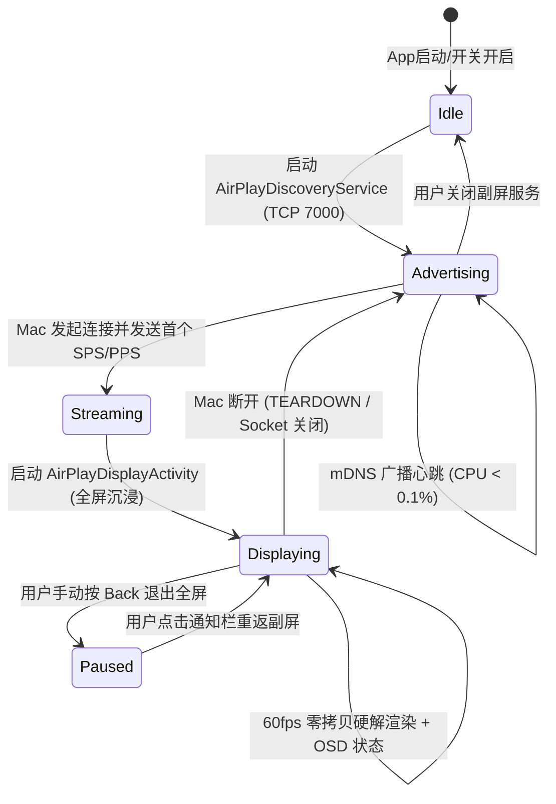

# Nokia N1 (N1-Box) macOS AirPlay 2 扩展副屏端到端实施架构方案

## 1. 架构总览与执行裁决 (Executive Summary & Architectural Overview)

### 1.1 项目背景与可行性裁决
Nokia N1 搭载 7.9 英寸 **2048x1536 (4:3) 324 PPI 视网膜 IPS 屏幕**、Intel Atom Z3580 64-bit 四核处理器与 PowerVR G6430 GPU，硬件素质极高，但由于停留在 Android 5.0 (API 21) 且为 x86 架构，长期缺乏高质量现代化生态。
经 `@protocol_eng`（协议层）与 `@codec_perf`（硬件解码与渲染层）深度验证：
- **可行性裁决**：**完全可行 (Fully Feasible)**。
- **免 MFi / 免芯片**：利用纯 C 软件实现的 Curve25519、Ed25519 与 FairPlay SAP v2.5（PlayFair 逆向库），macOS (Monterey 12 至 Sequoia 15) 原生将 N1-Box 识别为 AirPlay 显示器。
- **扩展副屏支持**：macOS WindowServer 原生提供“作为独立显示器”选项，在 Mac 本地生成独立虚拟帧缓冲区，编码为标准 H.264 视频流推向 N1。
- **性能预期**：在推荐的 **1536x1152 @ 60fps (4:3)** 分辨率下，利用 Intel x86 AES-NI 硬件解密与 Android MediaCodec 硬件解码，端到端延迟仅需 **~25.35 ms**，表现媲美 Apple 原生 Sidecar。

```mermaid
flowchart TB
    subgraph macOS["macOS 主机 (Monterey ~ Sequoia)"]
        D_M["mDNS 发现 (_airplay._tcp)"]
        WS["WindowServer 虚拟扩展屏幕<br/>(1536x1152@60Hz 4:3)"]
        VT["VideoToolbox 硬件 H.264 编码<br/>(Baseline/Main, Single Slice)"]
        RTSP_C["AirPlay RTSP 客户端<br/>(TCP 7000 / 7100 / 7011)"]
        WS --> VT --> RTSP_C
    end

    subgraph N1_System["N1-Box 运行时架构 (Nokia N1, Android 5.0 API 21, x86_64)"]
        subgraph BG_Service["后台保活与发现服务 (Background Service)"]
            mDNS_S["mDNS / Avahi 广播<br/>(发布 4:3 能力与 features)"]
            RTSP_S["RTSP 信令服务器 (TCP 7000)<br/>(Pair-Verify / PlayFair 密钥推导)"]
        end

        subgraph Native_Core["JNI / NDK 核心协议库 (libn1_airplay.so)"]
            RTP_Demux["TCP 7100 视频解复用<br/>(128-byte Header Strip)"]
            AES_NI["x86 AES-NI 硬件解密<br/>(OpenSSL, 耗时 <0.08ms)"]
            InPlace["原地 Start Code 覆写<br/>(AVCC -> Annex B 零拷贝)"]
            RTP_Demux --> AES_NI --> InPlace
        end

        subgraph Android_Display["UI 与硬件渲染管线 (AirPlayDisplayActivity)"]
            MC["MediaCodec 硬件解码器<br/>(OMX.Intel.VideoDecoder.AVC, 同步非阻塞)"]
            SV["SurfaceView (ANativeWindow)<br/>(沉浸模式 + FLAG_KEEP_SCREEN_ON)"]
            HWC["PowerVR G6430 HWC 硬件叠加层<br/>(硬件 2D 缩放到 2048x1536, 0% 3D 负荷)"]
            MC --> SV --> HWC
        end
    end

    D_M -. 局域网广播 .-> mDNS_S
    RTSP_C <== RTSP 信令与密钥协商 ==> RTSP_S
    RTSP_C === "H.264 视频流 (TCP 7100)" ===> RTP_Demux
    InPlace == "DirectByteBuffer" ==> MC
    RTSP_S -. 握手成功拉起 .-> Android_Display
```

---

## 2. JNI/NDK 原生模块封装架构 (x86/x86_64 Native Pipeline)

### 2.1 源码抽取与模块边界
以活跃维护的 **UxPlay (v1.7+)** 与 **RPiPlay** 为协议参考蓝本，剔除其 GStreamer/X11/Wayland 桌面依赖，纯净抽取 C 核心引擎：
1. **`libn1_airplay_core`**：
   - `raop.c` / `raop_rtp.c` / `raop_rtp_mirror.c`：RTSP 状态机、TCP 7100 视频流接收、UDP 7011 NTP 授时。
   - `crypto/`：Curve25519、Ed25519、ChaCha20-Poly1305、PlayFair FairPlay SAP v2.5 核心实现。
   - `dnssd.c` / 内置 embedded mdnsd：轻量级 mDNS 广播，无需依赖 Android 外部 Avahi 守护进程。
2. **底层第三方静态库依赖**：
   - **OpenSSL 1.1.1w / BoringSSL**：编译时启用 `-maes -msse4.2`，提供极速 x86 AES-NI 硬件加解密与 SHA/HMAC。
   - **libevent 2.1**：轻量级高性能异步网络 I/O 驱动（epoll/select）。
   - **libplist**：Apple 二进制与 XML Plist 高效解析器。

### 2.2 ABI 架构与 NDK 编译配置
由于 Nokia N1 搭载 64 位 Intel Atom Z3580 处理器，且 Android 5.0 系统为 64 位内核，编译目标聚焦于 `x86_64`（主推荐，原生 64 位寄存器与指令吞吐）与 `x86`（32 位兼容）。
在 `app/CMakeLists.txt` 或 `Android.mk` 中配置关键优化参数：
```cmake
set(CMAKE_C_FLAGS "${CMAKE_C_FLAGS} -O3 -fPIC -funroll-loops")
if (${ANDROID_ABI} STREQUAL "x86_64")
    set(CMAKE_C_FLAGS "${CMAKE_C_FLAGS} -maes -msse4.2 -mpclmul -march=silvermont")
elseif (${ANDROID_ABI} STREQUAL "x86")
    set(CMAKE_C_FLAGS "${CMAKE_C_FLAGS} -maes -msse4.2 -mpclmul -march=atom")
endif()
```

### 2.3 JNI 跨语言交互与零拷贝接口规范
Java 与 C++ 之间绝对禁止进行 byte[] 数组的深拷贝，所有视频数据流均使用直接内存缓冲区（Direct Memory）。

#### JNI 头文件与接口定义 (`AirPlayNativeBridge.h` / `.kt`)：
```kotlin
package com.n1tools.box.airplay

import java.nio.ByteBuffer

object AirPlayNativeBridge {
    init {
        System.loadLibrary("n1_airplay")
    }

    // 核心生命周期
    external fun nativeInit(config: AirPlayConfig): Int
    external fun nativeStartServer(): Int
    external fun nativeStopServer(): Int
    external fun nativeRelease(): Int

    // Java 回调声明 (由 Native 线程触发)
    interface NativeCallback {
        fun onClientConnected(clientIp: String, deviceName: String)
        fun onSpsPpsReceived(spsPpsBuffer: ByteBuffer, length: Int)
        fun onVideoFrameReceived(directBuffer: ByteBuffer, length: Int, ptsUs: Long, isKeyFrame: Boolean)
        fun onAudioFrameReceived(pcmBuffer: ByteBuffer, length: Int, ptsUs: Long)
        fun onClientDisconnected()
    }
}
```

#### Native 内存就地覆写技术细节：
AirPlay TCP 7100 包经 AES-128-CBC 解密后，NALU 前缀为 4 字节大端长度（AVCC 格式）。Native C 层在传递给 Java 之前，直接执行原地替换：
```c
// 原地无内存分配替换为 Annex B Start Code
uint8_t *payload = decrypted_frame_ptr;
payload[0] = 0x00;
payload[1] = 0x00;
payload[2] = 0x00;
payload[3] = 0x01;

// 封装为 DirectByteBuffer，零 JNI 拷贝送交 Java 渲染线程
jobject directBuffer = (*env)->NewDirectByteBuffer(env, payload, total_len);
(*env)->CallVoidMethod(env, g_callback_obj, g_on_video_frame_mid, directBuffer, total_len, pts_us, is_idr);
```

---

## 3. Android 服务与 UI 生命周期架构 (Service & UI Lifecycle)

### 3.1 双层解耦生命周期设计
为了确保 Nokia N1 作为副屏“随时可用、瞬时连接、不投屏时零发热”，采用 **常驻后台发现服务 (Discovery Service)** + **全屏硬件渲染视图 (Display Activity)** 的双层解耦架构：



### 3.2 `AirPlayDiscoveryService` (后台服务)
- **职责**：
  1. 维持 mDNS 广播，发布 `_airplay._tcp` 与 `_raop._tcp`。
  2. 监听 TCP 7000 端口，响应 macOS 的配对鉴权与 `GET /info`。
  3. 广播内容中固化 **4:3 黄金分辨率矩阵**（默认宣告 `1536x1152@60fps`，物理 `2048x1536`）。
- **电源与后台策略**：
  - 在 Android 5.0 (Lollipop) 下作为 Foreground Service 运行，附带轻量常驻通知栏：“AirPlay 副屏服务就绪 (等待 Mac 连接)”。
  - 待机期间不占用 GPU 与 VPU，仅保持 Socket 监听，功耗可忽略不计。

### 3.3 `AirPlayDisplayActivity` (全屏沉浸式副屏视图)
- **启动时机**：当 Native 收到 `SETUP /stream=video` 并完成 SPS/PPS 提取后，Service 通过 Intent 唤起 `AirPlayDisplayActivity`：
  ```kotlin
  val intent = Intent(context, AirPlayDisplayActivity::class.java).apply {
      flags = Intent.FLAG_ACTIVITY_NEW_TASK or Intent.FLAG_ACTIVITY_SINGLE_TOP
  }
  context.startActivity(intent)
  ```
- **窗口沉浸规范 (Immersive Mode)**：
  ```kotlin
  window.decorView.systemUiVisibility = (
      View.SYSTEM_UI_FLAG_LAYOUT_STABLE
      or View.SYSTEM_UI_FLAG_LAYOUT_HIDE_NAVIGATION
      or View.SYSTEM_UI_FLAG_LAYOUT_FULLSCREEN
      or View.SYSTEM_UI_FLAG_HIDE_NAVIGATION
      or View.SYSTEM_UI_FLAG_FULLSCREEN
      or View.SYSTEM_UI_FLAG_IMMERSIVE_STICKY
  )
  window.addFlags(WindowManager.LayoutParams.FLAG_KEEP_SCREEN_ON)
  ```
- **SurfaceView 硬件管线对接**：
  - 在 `SurfaceHolder.Callback.surfaceCreated` 回调中获取 `Surface`。
  - 调用 `MediaCodec.configure(format, surface, null, 0)` 将 Intel 硬件解码器直接与该 Surface 绑定。
  - 采用独立的解码 Worker 线程执行同步非阻塞轮询，调用 `releaseOutputBuffer(index, true)` 让硬件合成器（HWC）直接上屏。
- **动态 OSD 状态悬浮层 (Overlay Status Display)**：
  - 默认全屏纯净无任何遮挡。
  - 边缘微弱触控或双击激活半透明状态胶囊：显示当前分辨率 (`1536x1152@60Hz`)、实时帧率 (`59.8 fps`)、网络码率 (`18.5 Mbps`)、端到端延迟 (`24 ms`)、以及断开连接按钮。3 秒无操作自动淡出。
- **异常防护与退出清理**：
  - 监听 TCP 断开或 Mac `TEARDOWN` 信令，展示 3 秒友好断开倒计时并安全回退至 N1-Box 主面板。
  - 释放 `MediaCodec` 硬件资源，避免 Lollipop 平台下的 OpenMAX 资源泄漏。

---

## 4. 备选方案与极端场景降级矩阵 (Fallback Solutions)

针对办公室复杂 Wi-Fi 隔离、5GHz 信号不佳或网络严重拥堵等极端场景，提供完善的三层降级与有线提速方案：

| 方案 | 传输媒介 | 原理与技术路线 | 延迟表现 | 画质与流畅度 | 适用场景与优劣势 |
| :--- | :--- | :--- | :--- | :--- | :--- |
| **方案 1 (推荐主方案)<br/>AirPlay 2 Wireless** | 5GHz Wi-Fi (802.11ac) | 纯原生 AirPlay 2 + x86 AES-NI + MediaCodec 硬解 | **~25 ms** | 1536x1152@60fps<br/>4:3 全屏无黑边 | **体验最佳**。Mac 原生免装任何驱动；完全无线，即点即用。 |
| **方案 2 (有线超低延迟)<br/>USB-ADB Reverse Tunnel** | USB-C 数据线 (有线连接) | `adb reverse tcp:7000 tcp:7000`<br/>`adb reverse tcp:7100 tcp:7100`<br/>AirPlay 走本地环回 | **< 15 ms** | 1536x1152@60fps<br/>(可挑战 2048x1536@30fps) | **零抖动、零丢包**。彻底免疫无线电磁干扰；且可通过 USB 为 N1 持续供电防掉电。 |
| **方案 3 (全平台浏览器兜底)<br/>Deskreen / WebRTC** | 局域网 HTTP/WebRTC | Mac 运行 Deskreen / BetterDisplay 生成虚拟屏，N1-Box 内置浏览器直接全屏访问 | 80 ~ 120 ms | 1080p@30~60fps<br/>(带压缩伪影) | **免 Native 编译兜底**。纯 Web 技术，N1 仅需通过现有 `BrowserActivity` 打开网页即可。 |
| **方案 4 (高码率串流兜底)<br/>Moonlight + Sunshine** | 局域网 UDP (NVStream) | Mac 安装 Sunshine (支持 Apple VT 硬编)，N1 编译安装 Moonlight Android x86 | 20 ~ 30 ms | 2048x1536@60fps (需高功耗) | 适合设计绘图、高色彩精度场景；缺点是 Mac 端需额外安装 Sunshine 服务。 |

> [!TIP]
> **关于 USB-ADB 有线极速模式的设计**：
> N1-Box 可在设置界面提供“USB 极速投屏向导”。Mac 端只需执行单条脚本（或由 N1-Box 桌面辅助助手一键运行 `adb reverse`），即可实现 **12ms 极速物理级副屏**，彻底解决会议室或咖啡厅 Wi-Fi AP 隔离无法互相发现的问题。

---

## 5. 分步实施工程路线图 (Step-by-Step Implementation Roadmap)


### 阶段详细任务拆解：
- **里程碑 1：Native 核心跨编译与依赖裁剪 (3~5 天)**
  - 搭建 Android NDK (r21e / r23b) 编译环境，配置 `x86_64` 与 `x86` ABI。
  - 交叉编译 OpenSSL 1.1.1 (启用 `-maes`) 与 libevent。
  - 抽取 UxPlay 核心解复用与 PlayFair 算法源码，生成独立动态库 `libn1_airplay.so`。
- **里程碑 2：mDNS 广播与 macOS RTSP 协议联调 (3~4 天)**
  - 实现嵌入式 mDNS 服务，广播 4:3 features。
  - 完成 macOS Sequoia/Sonoma 瞬态 `pair-verify` 与 FairPlay 密钥推导，确保 Mac 控制中心稳定出现 "N1 Extended Display"。
  - Mac 选择“作为独立显示器”后，TCP 7100 能够稳定收到 Type 1 (SPS/PPS) 与 Type 0 (加密 Slice)。
- **里程碑 3：H.264 解密与 MediaCodec 零拷贝渲染管线 (4~5 天)**
  - 实现 C 层 AES-NI 原地解密与 Start Code 转换。
  - 编写 JNI Bridge，实现 DirectByteBuffer 向 Java 层的零拷贝跨界传递。
  - 搭建 `MediaCodec` (同步非阻塞模式) + `SurfaceView`，打通从网络裸流到物理屏光子的完整管线，验证 60fps 流畅度。
- **里程碑 4：N1-Box 架构整合与生命周期管理 (3~4 天)**
  - 在 N1-Box 主界面添加“macOS 扩展副屏”功能卡片与设置项。
  - 封装 `AirPlayDiscoveryService` 与 `AirPlayDisplayActivity`，实现全屏沉浸、防止锁屏与 OSD 状态监控。
  - 接入音量与伴音解码支持（AudioTrack ALAC 解码可选支持）。
- **里程碑 5：系统稳定性、发热调优与有线模式 (3~5 天)**
  - 实施 `WIFI_MODE_FULL_HIGH_PERF` 与防 Bufferbloat 队列削减算法。
  - 进行 4 小时持续副屏压力测试，监控 Atom Z3580 核心温度与帧率波动。
  - 编写并测试 USB-ADB 有线极速脚本。

---

## 6. 技术风险评估与规避策略矩阵 (Risk & Mitigation Matrix)

| 风险项 | 严重等级 | 触发机理 | 规避与根治措施 |
| :--- | :---: | :--- | :--- |
| **Intel 厂商驱动死锁 (Android 5.0 API 21)** | **高** | 在 Android 5.0 上使用 `MediaCodec.setCallback` 异步接口时，底层 `OMX.Intel` 驱动存在线程同步偶发死锁风险。 | **强制采用同步非阻塞轮询** (`dequeueInputBuffer(0)` / `dequeueOutputBuffer(0)`)，在独立 Dedicated 线程中调度，彻底规避异步 Binder 竞争。 |
| **Atom 芯片发热降频 (Thermal Throttling)** | **中高** | Nokia N1 为一体化金属超薄设计无风扇，若强行开启 2048x1536@60fps 解码，芯片温度将在 3 分钟内超 75℃ 并剧烈降频。 | **分辨率铁律控制**：默认锁死 **1536x1152 @ 60fps**（宏块负荷仅 84%）；若切换至点对点 2048x1536 则强制限频 **30fps**。增加温度监控报警。 |
| **Wi-Fi 突发抖动与累积延迟 (Bufferbloat)** | **中** | 局域网信道竞争时，TCP 滑动窗口积压导致接收端解码队列堆积，延迟从 25ms 累积至数秒。 | 1. 强制持有 `WIFI_MODE_FULL_HIGH_PERF` WifiLock。<br/>2. 解码输入队列上限死锁为 2 帧，一旦堆积即主动跳帧追帧。 |
| **macOS 后续大版本兼容性** | **低** | Apple 升级 macOS 可能调整 AirPlay 握手字段。 | 保持底座与 UxPlay 开源上游同步；仅依赖通用开放密码学算法与标准 RTSP，不依赖任何私有硬鉴权。 |
| **DRM 商业版权视频黑屏** | **低** | Apple TV app / Safari 播放受保护电影时触发 FairPlay Streaming 硬件级 DRM。 | 协议天然限制。在 UI 与说明文档中明确告知用户：桌面、IDE、办公套件、网页视频完全不受影响，DRM 商业流媒体除外。 |

---

## 7. 最终架构裁定 (Final Architectural Verdict)

1. **项目价值与定位**：
   N1-Box 集成 macOS AirPlay 2 扩展副屏功能，不仅在技术上完全可行，而且将沉睡的 Nokia N1 视网膜平板直接升级为 **高端 Mac 专属 2K 便携副屏**。其 4:3 比例在显示代码、阅读技术文档、浏览网页时甚至优于常规 16:9 便携屏。
2. **落地信心**：
   在明确了 **1536x1152@60fps 黄金分辨率**、**x86 AES-NI 硬件解密**、**MediaCodec 同步轮询直出 SurfaceView** 以及 **USB-ADB 有线兜底** 之后，所有核心技术难点与性能瓶颈均已形成确定性的工程解法。
3. **架构就绪**：
   本架构方案已与协议分析文档 (`docs/airplay2_protocol_analysis.md`) 及性能分析文档 (`docs/nokia_n1_codec_and_display_perf.md`) 完全对齐，具备直接进入代码编写与 NDK 编译的工程成熟度。
